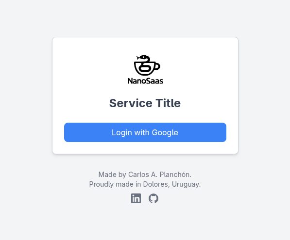
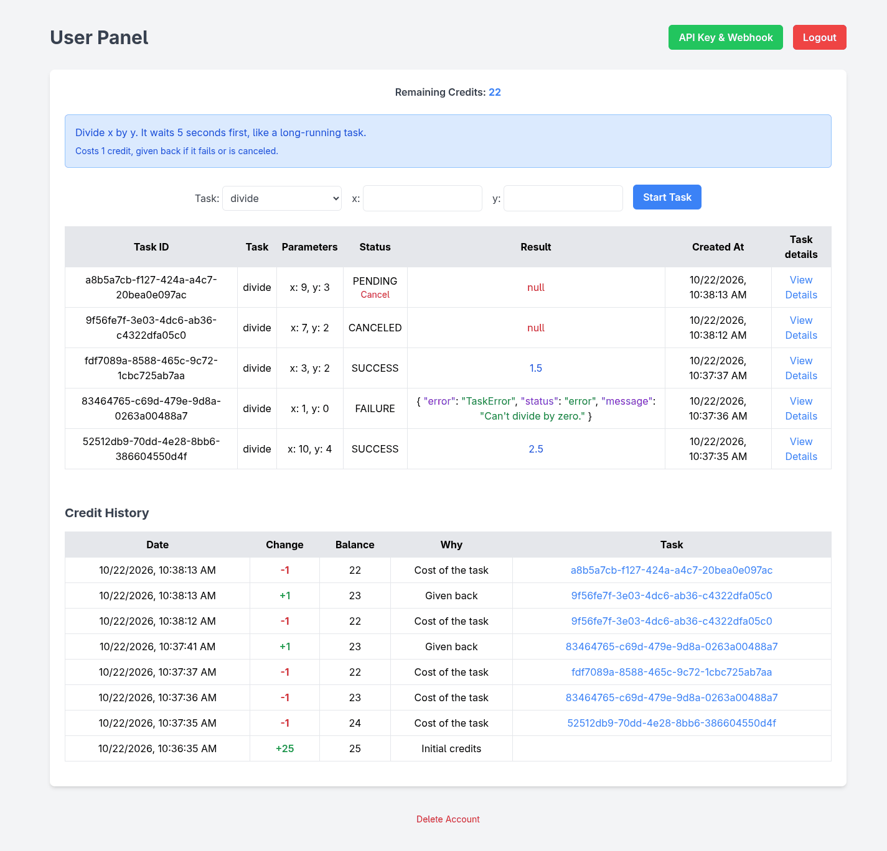

# NanoSaaS

NanoSaaS is a lightweight microservice platform for managing and tracking computational tasks. Designed with simplicity and scalability in mind, NanoSaaS is perfect for developers and small teams looking to automate background processes efficiently.

I built this system in just three days with almost no prior knowledge of web design or frontend development. While it works, the code quality might not adhere to the best practices, especially in terms of maintainability and structure. I encourage you to check the GitHub issues section, where I've documented the limitations and areas for improvement that I'm currently aware of.

---

## Features

- **Task Management**: Run and monitor background tasks using Celery.
- **Real-Time Updates**: Track task statuses and results in real time.
- **Secure Authentication**: Google SSO for easy and secure login.
- **Credits System**: Users are assigned credits to manage task execution, ensuring controlled resource usage.
- **Data Persistence**: PostgreSQL with Tortoise ORM for secure data management.
- **Modern UI**: Responsive frontend with Alpine.js and Tailwind CSS.
- **Scalable Architecture**: Built with FastAPI and Docker-ready.

### DeepWiki Docs: [https://deepwiki.com/carlosplanchon/nanosaas](https://deepwiki.com/carlosplanchon/nanosaas)

---

## Tech Stack

- **Backend**: FastAPI, Celery, Redis
- **Frontend**: Alpine.js, Tailwind CSS, Prism.js (to color the results' JSON)
- **Database**: PostgreSQL, Tortoise ORM
- **Authentication**: Google SSO

---

## Installation

Requires Python 3.11 or newer.

1. Clone the repository:
    ```bash
    git clone https://github.com/carlosplanchon/nanosaas.git
    cd nanosaas
    ```

2. Set up the environment:
    ```bash
    python3 -m venv .venv
    source .venv/bin/activate
    pip install -r requirements.txt
    ```

3. Configure the `config.toml` file:
    - Create it in the root directory from the provided template:
        ```bash
        cp config_template.toml config.toml
        ```
    - Fill in the required fields:
        ```toml
        [app]
        ROOT_PATH = ""  # Sub-path the app is served under, without slashes (e.g. "nanosaas"). Leave it empty to serve the app at the root.

        [api]
        # --- Internal Keys --- #
        JWT_SIGNING_SECRET_KEY = "your_secret_key"  # Used to sign JWTs; ensure this is a strong, secret key, at least 32 characters long.

        # --- Third parties keys --- #
        GOOGLE_CLIENT_ID = "your_google_client_id"
        GOOGLE_CLIENT_SECRET = "your_google_client_secret"
        GOOGLE_REDIRECT_URI = "http://127.0.0.1:8000/auth/callback"  # Must be an authorized redirect URI of your Google OAuth client.

        [database]
        DB_HOST = "your_db_host"
        DB_PORT = 5432  # Ensure this is an integer.
        DB_NAME = "your_database_name"
        DB_USERNAME = "your_db_username"
        DB_PASSWORD = "your_db_password"

        [celery]
        # Local Redis:
        broker="redis://127.0.0.1:6379/0"
        backend="redis://127.0.0.1:6379/0"
        # Optional, in seconds: how long a task can wait in the queue, and how long it can run.
        queue_timeout = 600
        time_limit = 600
        ```
    - Replace placeholders with your actual values. You can generate `JWT_SIGNING_SECRET_KEY` with `python scripts/generate_jwt_secret_key.py`.

4. Run the services:
    - **PostgreSQL**: Make sure PostgreSQL is running and configured. The tables are created automatically when the backend starts.
    - **Redis**: Start Redis (e.g., using Docker: `docker run -p 127.0.0.1:6379:6379 redis`). Binding the port to `127.0.0.1` keeps Redis reachable only from this machine: ports published by Docker skip firewalls like ufw.

5. Start the backend:
    ```bash
    uvicorn main_api:app --reload
    ```

6. Start the Celery worker in another terminal, with the virtual environment activated:
    ```bash
    celery -A celery_task worker --loglevel=info
    ```

Run both commands from the repository root: `config.toml`, the templates and the static files are loaded from the current directory.

---

## Usage

1. Access the application at `http://127.0.0.1:8000`.
2. Log in using Google SSO.

   

3. Create and manage tasks via the user dashboard.

   

4. Use the API with the key from the *API Key Management* page, sent in the `X-API-Key` header:
    ```bash
    curl -H "X-API-Key: your_api_key" http://127.0.0.1:8000/api/user_credits
    curl -H "X-API-Key: your_api_key" http://127.0.0.1:8000/api/task/divide/10/4
    curl -H "X-API-Key: your_api_key" http://127.0.0.1:8000/api/task_details/your_task_id
    ```
   The `api_key` query parameter still works for older clients, but avoid it: URLs end up in server and proxy logs. The interactive docs at `/docs` list every route.

   The page shows the whole key only when you generate it: the database keeps just its first characters and a hash of it.
5. Each user starts with a predefined number of credits (25 by default, set in `web/db_models.py`). A credit is reserved when a task is queued and given back if the task fails, so only successful tasks are charged. If credits run out, the user will need to wait or request more credits.

   A task that waits in the queue longer than `queue_timeout` seconds is dropped, and one that runs longer than `time_limit` seconds is stopped (10 minutes each by default, set in `config.toml`): either way it fails and its credit comes back. A task that never ends, for example because its worker died, fails the same way once both limits and one more minute have passed.
6. Customize your tasks by modifying the `celery_task.py` file. For example, the included `divide` task simulates a long-running operation in `run_divide()`:
    ```python
    async def run_divide(self, x, y, user_id):
        await init_db()

        try:
            time.sleep(5)  # Simulate a long-running operation
            result: float = x / y
        except Exception as e:
            # The credit was reserved when the task was queued, and only
            # successful runs are charged: give it back.
            await Account.refund_credit(user_id)
            return {
                "status": "error",
                "message": "An unexpected error occurred",
                "error": str(e),
            }
        finally:
            await Tortoise.close_connections()

        return result
    ```
   Replace or extend this function to implement your own task logic. When a task ends, the worker saves its status and result in the task history. If the task raises an exception, it ends as FAILURE and its credit is given back automatically; if it catches the error and returns a result instead, as `run_divide()` does, call `Account.refund_credit(user_id)` yourself. If your tasks take longer than 10 minutes, raise `time_limit`.

   Return plain Python values (dicts, lists, numbers or strings): Celery turns them into JSON. Don't return `json.dumps(...)`: the result would be saved as a string, and the API would show it with escaped quotes.
7. Customize the pages in `web/templates/`. Put images, icons and other static files in `web/static/`: they are served at `/web/static/`. In the templates, start their URLs with `{{ root_prefix }}` so they also work with a `ROOT_PATH`, as the logo in `login.html` does.

   The pages load Tailwind from `web/static/tailwind.css`, which only has the classes the templates use. After changing them, rebuild it with `python scripts/build_css.py`: it uses Tailwind's standalone CLI, which doesn't need Node.js and is downloaded the first time. The tests fail if a class in the templates is missing from it.

---

## Development Notes

- To monitor tasks:
    - Use **Flower** for Celery monitoring: install it with `pip install flower`, then run `celery -A celery_task flower --port=5555`.
    - Use the Celery TUI monitor: `celery -A celery_task events`.
- The database tables are created automatically when the backend starts (`generate_schemas=True` in `main_api.py`). For migrations, `shared.py` already has a `TORTOISE_ORM` config for **Aerich** (`pip install aerich`).
- `generate_schemas` only creates missing tables, so a database created before API keys became unique doesn't get their index. Add it by hand:
    ```sql
    ALTER TABLE account ADD CONSTRAINT account_api_key_key UNIQUE (api_key);
    ```
- A database created before API keys were hashed has them in plain text. Run `scripts/hash_api_keys.sql` once, with the app stopped, before starting this version; the keys keep working:
    ```bash
    psql -h your_db_host -p 5432 -U your_db_username -d your_database_name -f scripts/hash_api_keys.sql
    ```

---

## Tests

The tests need Docker running: they start PostgreSQL and Redis in containers with [testcontainers](https://testcontainers-python.readthedocs.io/), and run the backend and a Celery worker as separate processes, like in production. Your `config.toml` and your database are not touched.

```bash
pip install -r requirements-dev.txt
pytest
```

They take a minute or two: the example task waits 5 seconds, and with the broker down Celery retries for a while before giving up.

GitHub Actions runs them with Python 3.11 and 3.15 on every push to `main` and on every pull request (`.github/workflows/tests.yml`).

---

## Contributing

Contributions are welcome! Please fork the repository and submit a pull request. For major changes, please open an issue first to discuss your ideas.

---

## License

This project is licensed under the MIT License. See the `LICENSE` file for details.

---

## Acknowledgments

Built with ❤️ by [Carlos A. Planchón](https://github.com/carlosplanchon) in Dolores, Uruguay.
